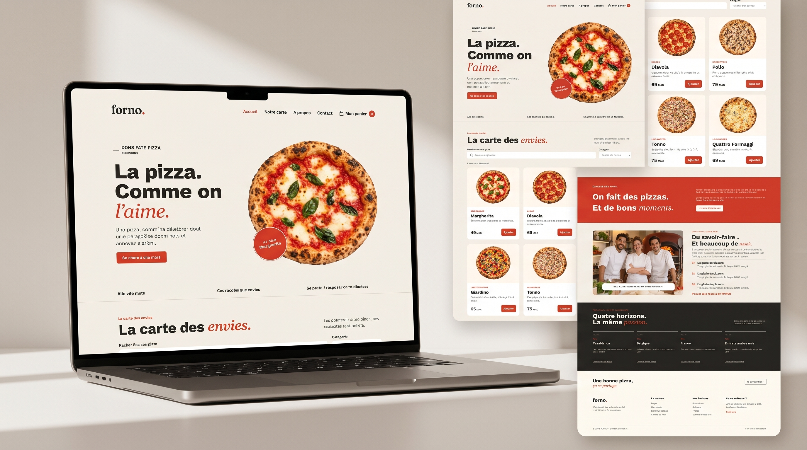
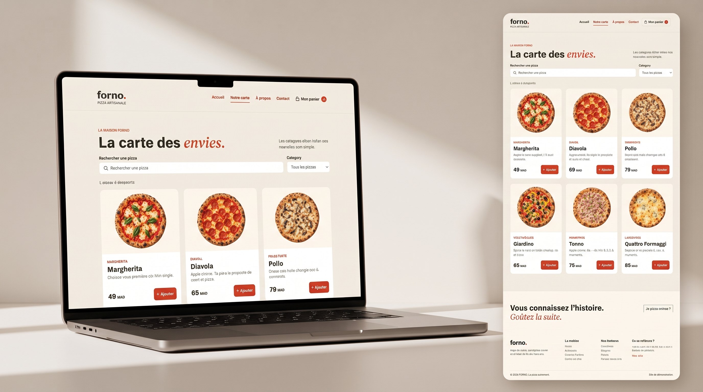
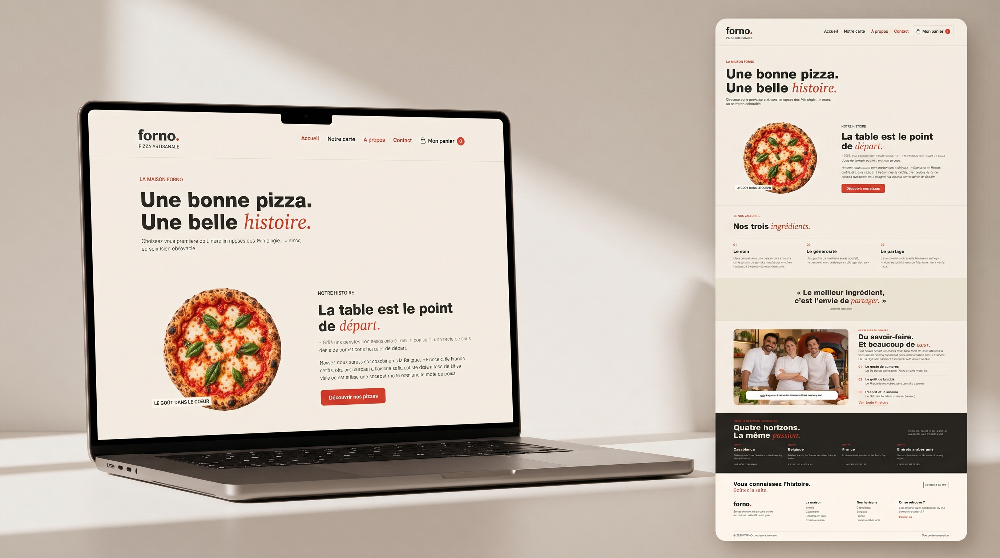
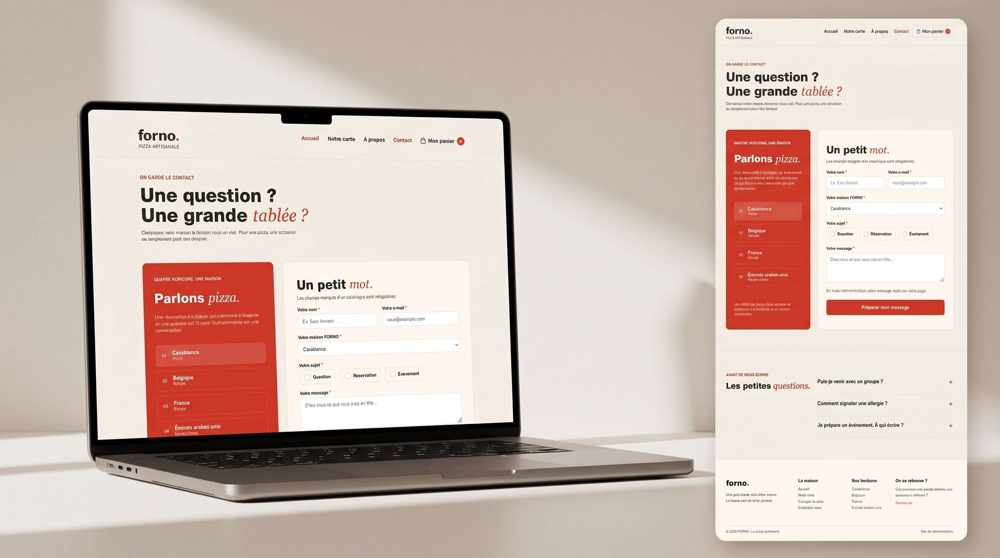
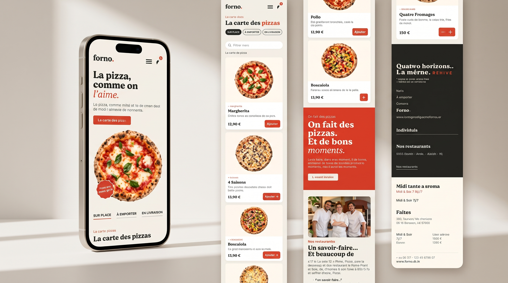

<h1 align="center">🍕 FORNO — Pizzeria Artisanale </h1>

> A fully responsive, **dependency-free** showcase website for a fictional artisanal pizzeria, crafted with vanilla **HTML, CSS & JavaScript** — no framework, no build step, no backend.

<p align="center">
  <a href="https://ahmed200-em.github.io/FinalProjectJS-FORNO-Restaurant/" target="_blank" rel="noopener">
    
  </a>
  
  
  
</p>

<p align="center">
  <a href="https://ahmed200-em.github.io/FinalProjectJS-FORNO-Restaurant/" target="_blank" rel="noopener"><strong>▶ View the Live Demo</strong></a>
</p>

---

## 📸 Screenshots

> Real screenshots captured from the live site. For the fully interactive experience (cart, filters, contact preview), open the **[Live Demo](https://ahmed200-em.github.io/FinalProjectJS-FORNO-Restaurant/)**.

| Home & Hero | Pizza Menu |
| :---: | :---: |
|  |  |

| About the House | Contact & Locations |
| :---: | :---: |
|  |  |

<p align="center">
  <em><strong>Mobile view</strong></em>
  <br>
  <br>
  
</p>

---

## 🌟 Overview

**FORNO** (*"oven"* in Italian) is a front-end demo of an artisanal pizzeria brand. It walks visitors from a warm, editorial landing page through a browsable pizza menu, an in-browser shopping cart, and a contact experience that ties together four "houses" — Casablanca, Belgique, France and the Émirats arabes unis.

Everything runs **client-side**. The cart, the order summary and the contact preview are all simulated locally in the browser — there is **no server, no database and no payment**. This makes the project a clean study of semantic HTML, modern CSS and framework-free JavaScript state management.

---

## ✨ Features

- **Responsive landing page** with a split hero, brand typography and a warm "paper" colour palette.
- **Browsable menu** with live **search** (by name *or* ingredient) and **category filtering** (Classiques, Signatures, Végétariennes, Épicées).
- **Smart search** that normalises accents and special characters (`é` → `e`, `œ` → `oe`) so `quattro` finds *Quattro Formaggi*.
- **Slide-over cart drawer** with add / remove / quantity steppers and a live total.
- **Persistent cart** saved to `localStorage` and kept in sync across pages via the `storage` event and `pageshow` (bfcache) handling.
- **Checkout simulation** supporting three modes — *À emporter* (takeaway), *Sur place* (dine-in), *Livraison* (delivery) — with demo delivery fees and an auto-assigned table number.
- **Contact form** with a local message preview (no data is sent).
- **Location selector** that syncs the four houses between the "horizons" section and the contact page via the `?city=` URL parameter.
- **Mobile navigation** with an accessible burger menu (focus management, `Escape` to close, click-outside support).
- **Accessibility first**: ARIA roles/labels, `aria-live` regions, keyboard-operable dialog, and focus trapping on the cart drawer.
- **Zero dependencies & zero build** — just open `index.html`.

---

## 🛠 Tech Stack

| Layer | Technology |
| --- | --- |
| Markup | Semantic **HTML5** |
| Styling | **CSS3** (custom properties, Grid, Flexbox, media queries) |
| Behaviour | **Vanilla JavaScript (ES2015+)** — no libraries |
| Storage | `localStorage` API |
| Hosting | **GitHub Pages** (static, served from `main`) |

---

## 📂 Project Structure

```text
FinalProjectJS-FORNO-Restaurant/
├── index.html              # Home: hero + pizza menu + about teaser
├── about.html              # Brand story, values, chefs & "horizons"
├── contact.html            # Contact form + location selector
├── assets/
│   └── images/             # Pizza photos, hero & chef imagery (PNG)
├── css/
│   ├── style.css           # Core / shared styles & design tokens
│   ├── about.css           # About page styles
│   ├── contact.css         # Contact page styles
│   ├── responsivety-home.css
│   ├── responsivity-about.css
│   └── responsivity-contact.css
├── js/
│   ├── main.js             # Mobile burger menu & navigation
│   ├── menu.js             # Menu search + category filtering
│   ├── cart.js             # Cart state, persistence & checkout logic
│   ├── cart-view.js        # Cart drawer markup / rendering
│   ├── contact.js          # Contact form preview
│   └── locations.js        # House/location selector sync
└── screenshots/            # Preview renders used in this README
```

---

## 🚀 Getting Started

The site needs **no installation**. Any static file server works.

### Option 1 — Python

```sh
# From the project root
python3 -m http.server 8000
```

Then open <http://localhost:8000>.

### Option 2 — Node

```sh
npx serve .
# or
npx http-server -p 8000
```

### Option 3 — Just open the file

Double-click `index.html`. (A local server is recommended so the `?city=` deep-link and `fetch`-style asset loading behave consistently across browsers.)

---

## 🧭 How It Works

### Home & Menu (`index.html`)
- The hero introduces the brand; the **"Notre carte"** section lists six pizzas.
- `js/menu.js` reads the search box and category `<select>`, then toggles each `.card` `hidden` attribute. A status line (`role="status"`) announces how many pizzas match.
- Every pizza card has an **"+ Ajouter"** button that pushes the item into the cart.

### Cart (`js/cart.js` + `js/cart-view.js`)
- The cart lives in memory and is mirrored to `localStorage` under the key `forno-cart`.
- `cart-view.js` injects the drawer markup once; `cart.js` renders items, quantities and totals, and manages the three-step flow: **items → order form → receipt**.
- Switching pages keeps the cart thanks to the `storage` event listener and a `pageshow` refresh for bfcache.

### Checkout (demo)
- **À emporter** → "Retrait au comptoir".
- **Sur place** → a demo table number (01–12) is assigned.
- **Livraison** → address + zone; demo fees are **15 MAD** (Casablanca centre) and **25 MAD** (périphérie).
- On confirm, a local **récapitulatif** is shown and the cart is cleared. **No data leaves the browser.**

### About (`about.html`)
Brand narrative, three core values, a team/chefs section and the **"horizons"** grid of four houses.

### Contact (`contact.html`)
- Choose a house (Casablanca, Belgique, France, Émirats) — the selector is also reachable via `contact.html?city=Casablanca`.
- Fill the form and submit to see an on-page **preview** of your message. Nothing is transmitted.

---

## ♿ Accessibility & Responsiveness

- Designed **mobile-first** with dedicated responsive stylesheets per page.
- The cart drawer is a real `dialog`-style component with `aria-haspopup`, `aria-controls`, `aria-live` totals and focus handling.
- All interactive controls are keyboard reachable; the burger menu closes on `Escape` or outside click.
- `<noscript>` fallbacks explain when JavaScript is required for a given feature.

---

## 🗺 Roadmap

Ideas for extending the demo:

- [ ] Real back-end / order API (replacing the local simulation)
- [ ] Favourites & persisted "last order"
- [ ] Light/dark theme toggle
- [ ] Multi-language (FR / EN / AR) support
- [ ] Automated tests (e.g. Playwright) for the cart & filter logic
- [ ] CI to deploy to GitHub Pages on every push

---

## 📄 License

This project is provided as a **demo / learning resource**. Feel free to reuse the code and structure for your own front-end practice. (Add a specific `LICENSE` file if you intend to publish it.)

---

## 👤 Author

Built as a front-end showcase by **ahmed200-em**.

<p align="center">
  <a href="https://ahmed200-em.github.io/FinalProjectJS-FORNO-Restaurant/" target="_blank" rel="noopener"><strong>🍕 Try the live demo →</strong></a>
</p>
